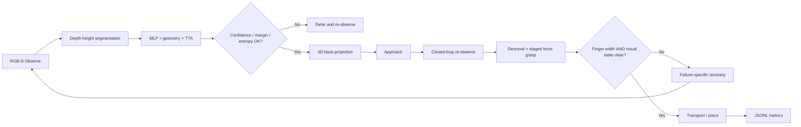

# AI Shape Sorting Robot Arm - Advanced Genesis 3D Edition

Franka Panda と固定上方 RGB-D カメラを使い、`circle / square / triangle` を認識して対応ビンへ仕分ける Physical AI 課題の上級編です。既存 Genesis 版の「深度切り出し -> MLP 分類 -> 3D 位置推定 -> IK/PD -> 力把持 -> 再試行」を基礎に、**認識の不確実性、動作直前の再観測、二重の把持確認、失敗別リカバリ、定量ログ**を追加しました。

> **検証範囲（この環境での実測）**: オフライン（pytest 9/9、`test_offline.py` pass）および Genesis GPU（RTX 4090, `gs.cuda`）実行済み。
> - 1 episode: success_rate **1.0**（3/3）
> - 2 episodes: success_rate **0.71**（5/7）、classification_accuracy **0.86**
> - 再現動画: `out/genesis/PAI_final_demo_repro_03_advanced.mp4`（5 episodes / 約150秒、success_rate 0.67）
> - 実行時に overhead カメラ遮蔽・完了物体の再選択ループを回避する修正を `genesis3d/genesis_sort_advanced.py` に反映済み。

## 1. 上級編で追加したもの

| 項目 | ベースライン | 上級編 |
|---|---|---|
| 形状 AI | MLP の最大確率を採用 | MLP + 幾何特徴 + morphology TTA。確率差と正規化 entropy も算出 |
| 誤認識対策 | 常に 3 クラスへ決定 | 低信頼・小 margin・高 entropy・深度不安定を拒否して後回し |
| 3D 推定 | 画像軸候補から自動合わせ | カメラ内部行列と `T_world_cam` による明示的な pinhole 逆投影 |
| 動作 | 1 回の観測で把持まで実行 | Approach 後に再観測し、対象の移動を補正してから Descend |
| 把持判定 | 指開き幅 | 指開き幅 **かつ** 物体がテーブル面から消えたことを RGB-D で確認 |
| 再試行 | 同様の動作を再実行 | 失敗別に XY offset、把持 yaw、力、退避高さを変更。回数上限あり |
| 評価 | 終了時 JSON | 事象 JSONL + summary JSON。成功率、分類精度、平均試行数、失敗分布 |

## 2. 構成

```text
AI_Shape_Sorting_Robot_Arm_Advanced/
├── shape_ai.py                         # 合成学習、幾何特徴、TTA、不確実性
├── perception.py                       # 深度分割、pinhole 逆投影、対象関連付け
├── supervisor.py                       # 選択、二重検証、失敗別 recovery policy
├── telemetry.py                        # JSONL ログと集計
├── test_offline.py                     # Genesis 不要の end-to-end テスト
├── genesis3d/genesis_sort_advanced.py  # Genesis 本番 entry point
├── configs/advanced.json               # 閾値、workspace、grasp、camera 設定
├── models/shape_mlp_advanced.joblib    # 学習済みモデル
├── tests/                              # pytest 9 tests
├── docs/GENESIS_RUN_CHECKLIST.md       # 本番確認手順
├── docs/VIDEO_STORYBOARD.md             # 1〜3分動画の構成案
└── report/                              # 提出用 PDF/DOCX
```

## 3. 制御フロー



## 4. セットアップ

Python 3.10〜3.12 を想定します。

```bash
python -m venv .venv
source .venv/bin/activate       # Windows: .venv\Scripts\activate
pip install -r requirements.txt
```

Genesis 実行時のみ追加します。

```bash
pip install -r requirements-genesis.txt
# headless Linux の例
export PYOPENGL_PLATFORM=egl
```

## 5. まずオフライン確認

```bash
python -m pytest -q
python test_offline.py
```

期待値:

- pytest: `9 passed`
- `out/offline/offline_results.json` の `pass`: `true`
- `circle / square / triangle` が各 1 個検出
- `out/offline/offline_rgbd_result.png` に輪郭、信頼度、entropy が表示

モデルを再学習する場合:

```bash
python shape_ai.py --train --model models/shape_mlp_advanced.joblib
```

同梱モデルは seed 7、各クラス 1,400 枚の合成シルエットで学習し、固定 hold-out で accuracy 0.9978 を記録しました。これは合成データ内の値で、Genesis 実画像での性能保証ではありません。

## 6. Genesis 実行

```bash
python genesis3d/genesis_sort_advanced.py --cpu --vis --episodes 1
# GPU/headless の例
python genesis3d/genesis_sort_advanced.py --episodes 2
```

主な出力:

- `out/genesis/genesis_raw.mp4`
- `out/genesis/events.jsonl`
- `out/genesis/summary.json`

動画の互換変換:

```bash
ffmpeg -i out/genesis/genesis_raw.mp4 -c:v libx264 -pix_fmt yuv420p out/genesis/genesis_demo.mp4
```

## 7. 成否判定とリカバリ

- **認識保留**: `confidence < 0.72`、`margin < 0.24`、`entropy > 0.68`、または深度 MAD が大きい対象はつかまない。
- **空振り**: 指開き幅が狭い、または持ち上げ後も元位置にテーブル面の対象が残る場合。XY offset、顎方向、力を変更して再試行。
- **IK failure**: 高い退避姿勢に戻し、別 offset から再接近。
- **slip**: 運搬前後の指開き幅が急減した場合。安全上限内で把持力を増やす。
- **retry budget**: 1 物体あたり最大 3 回。無限ループを避け、失敗をログに残す。

## 8. 提出前に確認すること

1. `configs/advanced.json` のカメラ pose / FOV / resolution が Genesis scene と一致している。
2. 机の深度、物体高、workspace、bin 座標を 1 episode で確認する。
3. `events.jsonl` で `target_lost / empty_grasp / slip / ik_failed` を区別できる。
4. 動画は 1〜3分、倍速使用時は動画内か概要欄に明記する。
5. 公開リポジトリに氏名、所属、メール、秘密情報を含めない。
6. README 冒頭の「Genesis 未確認」を、実行後に実測結果へ更新する。

## 9. 注意点

- 上方カメラが完全な top-down であること、テーブルがほぼ平面であることを前提にしています。
- Genesis の API は版によって `camera.render()` や IK の戻り値が変わる場合があります。
- 合成 accuracy と実際の仕分け成功率は別指標です。最終報告では `summary.json` の成功率・再試行・失敗分布を優先してください。
- `true_label` と最終物体位置はシミュレーション評価にだけ使い、制御判断には使いません。

## License

MIT License. See `LICENSE`.
